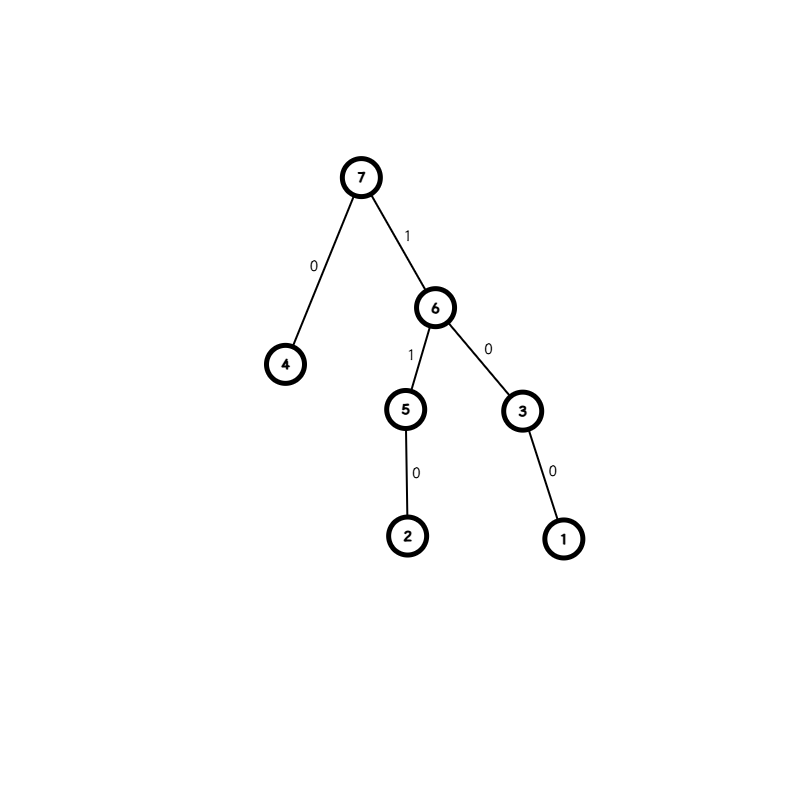
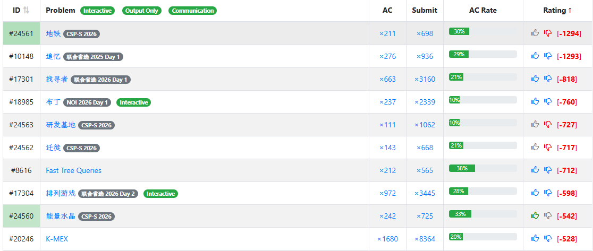
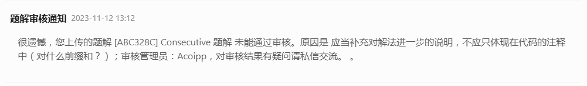

没错，新系列！而且可能以后每年都会有！~~可能还会补以前的。~~

努力用最简单朴实的语言来讲，大佬可能会觉得啰嗦但是 ~~应该~~ 比较适合萌新蒟蒻食用 OwO。

# 事先说明

难度分类：入门、普及、提高、省选、NOI、CTS、IOI

其中「入门」难度仅限纯语法题，不会出现任何算法。其余等级按上位、下位可能会拆分 $+$ 和 $-$。「普及+」简单于「提高-」，其它同理。

题目评价会综合考虑 idea、题面、数据、样例、难度、位置、思路等多个方面，或多会少也可能会有社会评价。按照锐评的通用规则，从高到低分别是「夯」「顶级」「人上人」「NPC」「拉完了」共 $5$ 等，可能会有些其它评论。

# CSP-J

## T1 旅游/Travel

### 题意

给你两张车票，然你分别判断是否在：

- 同一个车厢
- 同一排
- 过道的同一侧
- 相邻

保证车票是中国铁路二等座车的合法席位。

### 分析

#### Hints

题目太简单，不需要 Hints，~~也写不出来。~~

#### 解答

语法题。车厢和排很好判断，直接判是否相等即可（`string` 是可以像整数一样使用大部分运算的！）。过道的同一侧的话按照 `<='C'`（是的，根据 ASCII 编码，字符是可以比较的，而且 ASCII 编码中大小写相同的情况下就是按照字母顺序排的）。然后相邻的话按照题意，分别判断 'A' 与 'B'、'B' 与 'C'……即可。

注意我国的火车车票同飞机，是没有 E 座的，只有 ABCDF（据说是“1”与“E”读音相近，但似乎不能解释为什么航空领域也没有）。题目中每时每刻都是 ABCDF，写成 'E' 挂 $15$ 分，可能就从二级变三级了——基础题一定要拿满！这也就是说通过 ASCII 码相邻判断是错的。

但是这样子的话一个一个判断似乎不太优雅，所以也可以写一个小函数分别将 ABCDF 映射成 01234（也可以是 12345 或者其它别的，随意），然后就可以用相邻来判断了。

### 代码

赛场代码（注释是现补的）：

```cpp
#include <bits/stdc++.h>

#define FOR(i, j, k) for(int i = j;i <= k;++i)
#define INF 0x3f3f3f3f

using namespace std;

typedef long long ll;
typedef pair<int, int> PII;

int x, y;
string c1, c2, s1, s2;

inline int convert(char c) {  /* 映射函数，映射成啥随意。 */
	switch(c) {  /* swithc 语句可以用来判字符；不会的可以见本站有关文章。 */
		case 'A': return 0; /* return 直接结束函数，不需要再 break; */
		case 'B': return 1;
		case 'C': return 2;  /* 不相邻的座位，虽然对我们的判断没有影响但分开似乎更符合直觉一点。 */
		case 'D': return 4;
		case 'F': return 5;
	}
}

int main() {
	freopen("travel.in", "r", stdin);  /* 为不写 freopen、freopen 写错的童鞋默哀 1 秒钟。 */
	freopen("travel.out", "w", stdout);
	ios::sync_with_stdio(false);  /* 可有可无的读入输出优化——CCF 明确不考察常系数。 */
	cin.tie(nullptr);  /* 同上。 */  
	cin >> c1 >> s1 >> c2 >> s2;
	if(c1 != c2) {
		cout << "0000";  /* 不在一个车厢当然不同排、不在一侧、不相邻；其它同理，前面的是 0 后面的都是。 */
		return 0;
	} else {
		cout << "1";  /*  一定在一个车厢了。 */
		if(s1[0] != s2[0]) cout << "000";
		else if(s1[1] != s2[1]) cout << "000";
		else {
			cout << "1";
			x = convert(s1[2]), y = convert(s2[2]);
			if(!((x <= 2 && y <= 2) || (x >= 4 && y >= 4))) cout << "00";
			else {
				cout << "1";
				if(max(x, y) - min(x, y) == 1) cout << "1";  /* 不知道谁大谁小就强制大 - 小；使用绝对值也是可以的。 */
				else cout << "0";
			}
		}
	}
	return 0;
}
```

[AC 记录](https://qoj.ac/submission/3386005)

### 难度与评价

难度：入门

算法：模拟；条件语句

考察的都是 [CCF NOI 大纲](https://www.noi.cn/upload/resources/file/2025/04/18/NOI_Syllabus_Edition_2025.pdf) $2$ 级及以下内容。

综合给到「顶级」。

理由：

1. 题目确实简单，语法题，符合其入门级第一题送分的定位。
2. 配了图，用词基础，方便选手理解；题面简单好懂，且多次提示 D、F。
3. 数据质量过关，什么 case 基本都涵盖了。
4. 但是题面略长且不少选手以为是 ABCDE 而且样例没有这种情况从而被创飞导致降级（不过我个人认为不好好看题想当然活该挂分不应该怪到题目上）。

QOJ 上对这题评价是负的，我个人不太同意。题目确实简单、不需要太多思考，但位置也是语言送分题，它结合生活情景完成了这个目标，且没有数据等问题，这就说明题目本身是不错的——至少达到了它的目标。至于样例过弱的问题——一方面确实题目可以加强；另一方面学好对拍吧。这也是题目可以改进的地方，但不妨碍题目本身的质量。

## T2 回文串/string

### 题意

有一个字符串 $s$。我们将它分成 $i$ 段，第 $i$ 段中某个字符 $c_i$ 连续出现了 $a_i$ 次。每次可以将一个字符改动成任意字符，求最少几次改动能让它变成回文串。段数 $n \le 2 \times 10^5, $a_i \le 10^9$。

### 分析

#### Hints

1. 什么情况下需要进行改变？
2. 如果进行改变，改变成什么最好？
3. 考虑到字符串长度最大可能达到 $2 \times 10^5 \times 1 \times 10^9 = 2 \times 10^{14}$，显然无法拼接之后模拟。能不能快速的统计而非一个一个字符检索？

#### 解答

回文本质上是在要求对称的两个字符相等。我们发现如果两个位置对应的字符不相等一定要改动一个。而且改变的话当然是改变成与对方相同的，至于是谁改成谁无所谓，因为这个位置的情况与其它位置无关，也不对其它位置产生影响。

也就是说，我们只需要统计对应字符不同的位置有几个就好了！直接把 $s$ 拼出来，可通过 $1 \sim 12$ 以及 $17 \sim 21$ 一共 $17$ 个点得 $68$ 分。

那为什么拿不满呢？因为 $a_i$ 太大了！拼上去时空都爆了。我们希望能够忽略掉 $a_i$ 的影响。我们在 Hints $3$ 中提到，希望不要一个一个字符检索。

如果好几个位置情况相同，那我们当然希望一块处理啊！那哪些位置情况相同呢？一段内的字符是相同的啊！

我们使用**双指针**算法。具体来讲：

1. 我们定义 $l$ 和 $r$ 两个“哨兵”。初始时，$l$ 在 $1$ 处，$r$ 在 $n$ 处。
2. 我们能考虑的就是二者中较短的那一段。以 $a_l \le a_r$ 为例。虽然 $r$ 对应段更长，但我们不知道超过 $a_l$ 部分的信息，无法判断。我们只能判断 $a_l$ 这么多的部分，它们对应的字符分别就是 $c_l$ 和 $c_r$。如果不同，那我们就应该把这部分全部改成 $c_l$，因此就往答案加上 $a_l$，相等就不用加。
3. 然后 $a_r \gets a_r - a_l$，因为长为 $a_l$ 的这一段被考虑完了不用再考虑了，当然要继续推进。$a_l \gets a_l - a_l$ 同理，但是减完了。所以我们要让 $l \gets l + 1$ 以便考虑下一段。
4. 如果 $a_l > a_r$，反过来即可。

由于每次至少会推进一段，所以最多只有 $n$ 段，$n \le 2 \times 10^5$ 可以通过。

### 代码

```cpp
#include <bits/stdc++.h>

#define FOR(i, j, k) for(ll i = j;i <= k;++i)
#define INF 0x3f3f3f3f

using namespace std;

typedef long long ll;
typedef pair<ll, ll> PII;

const ll N = 2e5 + 10;
ll l, n, r, ans, sum;
pair<ll, char> a[N];  /* 积木鱼习惯把相关而且要在一起的两样东西打包成 pair；你也可以用 int a[N] 和 char c[N] 分别管理。 */

int main() {
	freopen("string.in", "r", stdin);
	freopen("string.out", "w", stdout);
	ios::sync_with_stdio(false);
	cin.tie(nullptr);
	cin >> n;
	FOR(i, 1, n) {
		cin >> a[i].first >> a[i].second;
		sum += a[i].first;  /* 统计字符串长度；然而并没有用，可以删除。 */
	}
	l = 1, r = n;
	while(l <= r) {  /* 双指针通用条件：如果 l > r，即左端点比右端点还大，那就当然不用搜了。 */
		if(a[r].first >= a[l].first) {
			if(a[r].second != a[l].second) ans += a[l].first;
			a[r].first -= a[l].first;
			++l;
			/* 
			如果 a[r].first == a[l].first，那么这轮操作后 a[r].first = 0, 下一次的时候一定会进入下面的 case。由于 a[r].first == 0，因此用到的两次运算都是空转影响两个数，但是执行了最后的 --r，因此也是正确的。
			*/
		} else {
			if(a[r].second != a[l].second) ans += a[r].first;
			a[l].first -= a[r].first;
			--r;
		}
	}
	cout << ans;
	return 0;
}
```

[AC 记录](https://qoj.ac/submission/3386015)

### 难度与评价

难度：普及-

算法：模拟；双指针

你说得对，但是 [CCF NOI 大纲](https://www.noi.cn/upload/resources/file/2025/04/18/NOI_Syllabus_Edition_2025.pdf)里并没有「双指针」这个名字。

直接给到「夯」：

理由：

1. 题目确实考察了简单算法，但是很好想，推导很自然。
2. 对于不会算法的同学，给到了简单模拟的充足部分分，且对推导正解有一定帮助。
3. 数据质量过关，没有出现严重问题。
4. 确实比较板比较套路，但既然是该算法的入门题本身就不应当有太过复杂的转化。

QOJ 上对这题评价也是负的，我个人不太同意。这是本场出的最好的题目，我挑不出来一丁点儿毛病——位置、数据、做法、部分分、题面……相当完美。可能只是题面用了 $\sum$ 等符号，但对于 $L$ 的含义题目解释了是「长度」，不算造成太大影响，而且 [中学生](https://www.noi.cn/gynoi/tlgd/2025-02-13/837978.shtml) 也算可以接受，无伤大雅。

## T3 按位与/and

~~大份要来了。~~

### 题意

有 $n$ 个非负整数，选择 $m$ 个，请问怎样选择能使这 $m$ 个数按位与下结果最大？输出最大值。

### 分析

#### Hints

1. 我们当然要从二进制考虑该问题。怎么在二进制下比较两个数的大小？
2. 如果我们希望最大化取值，我们应该怎么做？
3. 如何说明这么做是对的？

#### 解答

二进制也是从高位到低位比较啊！因此我们需要最大化高位的值。

正确比较显然（~~其实就是不太能证~~），例如说 $2^6 = (1000000)_2, (0111111)_2 = 2^6 - 1$。

我们认为一个数从低到高有 $0 \sim 30$ 这些位，比如 $(10)_2$ 的第 $0$ 位是 $0$，第 $1$ 位是 $1$。因为高位影响权大，所以从我们从高到低考虑。我们当然尽量希望为 $1$，因此如果可行一定会固定让它为 $1$。然后再来尝试下一位，一直到第 $0$ 位。

因此我们的问题变成了 **在保留前面几位的结果基础上** 要让第 $X$ 位为 $1$ 怎么做。

我们考虑一个「掩码」，它的值就是前几位的答案基础上让正在处理的那一位变成 $1$。这样既不会干扰前面的答案，也不会影响后面的判断（没有赋值的二进制位默认是 $0$），还让这一位变成了 $1$。然后分别扫一下整个序列，如果能让这些 $1$ 位都能保留的值的数量不少于 $m$ 那么这一位就可以变成 $1$。

#### 部分分

最后说一下部分分。

直接从大到小贪心是错的，反例有 $24 \space 5 \space 3$ 等，但是这样子可以拿 $45$ 分——因为它确实在随机数据下正确率很高，毕竟最大值往往也就意味着高位更大。这个做法可以过掉 $5$ 个大样例的 $4$ 个，如果特判掉 $n = 2^k, k \in \mathbb{N}$ 就全过了。不过能拿近一半的分数还是要说数据不够强。

对于前 $5$ 个点，$n \le 20$，直接 dfs 尝试选与不选即可。

对于点 $6$，$m = 1$，当然选择最大值。

对于点 $7$，$m = n$，那自然全部要用。

对于点 $8 \sim 10$，$m = 2, n \le 2000$，直接 $\mathcal{O}(n ^2)$ 枚举两个数即可。

[以上方法全部结合考场亲测得 $90$ 分](https://qoj.ac/submission/3386021)，~~一点儿正解没写~~ 但是将近满分了！

### 代码

```cpp
#include <bits/stdc++.h>

#define FOR(i, j, k) for(ll i = j;i <= k;++i)
#define INF 0x3f3f3f3f

using namespace std;

typedef long long ll;
typedef pair<ll, ll> PII;

const int N = 2e5 + 10;
int m, n, t, x, a[N], ans, cnt;

int main() {
	freopen("and.in", "r", stdin);
	freopen("and.out", "w", stdout);
	ios::sync_with_stdio(false);
	cin.tie(nullptr);
	cin >> n >> m;
	FOR(i, 1, n) cin >> a[i];
	for(int i = 30;i >= 0;--i) {
		x = ans | (1 << i), cnt = 0;
		FOR(j, 1, n) if((a[j] & x) == x) ++cnt;
		/*
		个人觉得这段写法比较巧妙，解释一下。
		首先 1 << i 就是让低到高第 i 位变成 1，其它位置仍然是 0，再按位或上就可以保证不影响其它位置而让对应位置变成 1；
		然后如果 a[j] & x == x，那么说说明 x 有的 a[j] 都要有，至于 a[j] 有的但是 x 本来就没选自然没办法了。
		*/
		if(cnt >= m) ans = x;
	}
	cout << ans;
	return 0;
}
```

实际有效的部分不多。

[提交记录](https://qoj.ac/submission/3412622)。

### 难度与评价

难度：~~不好说~~ 普及

算法：贪心；Trick

贪心属于 [CCF NOI 大纲](https://www.noi.cn/upload/resources/file/2025/04/18/NOI_Syllabus_Edition_2025.pdf) $3$ 级内容。

但我更倾向于这题是个 trick 题，没做过这种贪的哪怕你能考场上发明出反悔贪心切掉 [S 组的社团招新](https://qoj.ac/contest/2571/problem/14597/statement/) 你也写不出来（~~没错说的就是积木鱼这条大杂鱼~~），尤其是你看着代码写的还是比较精妙的。思路对于冲 T3 正解的选手来讲应该算是很好想的。

综合评价：给到「NPC」，理由：

1. 大样例和数据比较水，明显错误做法能过全部大样例和将近一半的测试点。
2. trick 题，想出思路和实现不太一回事儿。
3. **这个结论比较广为人知了**。
4. 但是部分分给的很多，照顾了骗分选手。就是可能有点过多了。

QOJ 上这题点踩的不少，仅次于创飞了一车选手的 T1，不过考虑到 T1 这些多是被 E 座坑了来泄愤的所以可见这题真的不算好。

## T4 纸牌游戏/card

实话说，我写这篇文章的 idea 就是想喷这道垃圾，可以说是为了这碟馊醋包的这顿饺子。

> [!NOTE] 提示
> 本题难度很高，实在看不懂的大部分入门级选手以及刚转提高的选手可以忽略。积木鱼自己也弄了好几天才看明白，而做这篇的时候积木鱼已经是有 [CCF中学生程序设计能力等级评价](https://www.noi.cn/xw/2019-08-26/715369.shtml) $6$ 级，即提高级位居全国前 $20\%$ 实力的选手了。也就是说，这题已经有 S 组 T2 以上的难度了（当然，考虑到体感难度有个人差，可以先试着理解，不理解跳过也无伤大雅）。

### 题意

首先题面就写的依托答辩——因为这个 idea 本身就不咋地。

有 $n$ 张牌，点数都不超过 $m$，而且每种点数至少都有 $1$ 次。第 $i$ 局从第 $i$ 张牌开始打到第 $n$ 张。如果即将打出的牌 $A$ 点数与桌面上已有的牌 $B$ 相同，那么 $B$ 及比 $B$ 更晚打出的牌都会被收走。然后再把 $A$ 放进去。

对于 $i = 1, 2, \ldots m$，求 $n$ 局之后，有多少局结束的时候有点数为 $i$ 的牌。

### 分析

#### Hints

1. 我们考虑贡献法。哪些牌会最终留下贡献？
2. 如果我们正着遍历，“删掉相同”是不是可以变成“跳过去”？
3. 跳过去之后，局面会变成什么样？
4. 怎么最终统计它的贡献？

#### 解答

> [!NOTE] 提示
> 再次提醒，实在弄不明白可以直接跳过。

我们发现（发现方法：手玩样例和集中注意力观察题面；性质题、结论题是这样子的）如果某张牌 $X$ 花色是 $i$，那么下一个 $i$ 的牌 $Y$ 会消掉 $X$ 到 $Y$ 之间的所有牌。**那么前面的牌相当于没打（因为被收走了）。** （哪怕它们内部已经有了收走的关系，不影响，反正最后都是走了）所以和直接从牌 $Y$ 开始是一样的。也就是说，不断重复这样的操作，**如果某牌不是某种花色的最后一张牌，那么它的贡献可以合并到同花色的最后一张牌处理。** 我们将花色 $a$ 的最后一张牌记做 $lst_a$。

而且，因为后面没有牌花色会与 $lst_i$ 相同，而其它牌都比 $lst_i$ 晚打出，不可能消掉 $lst_i$，**因此它一定会产生贡献。** 那么 $lst_i$ 也可以忽略，因为后面的东西与它无关了。

这样子我们发现我们的一局游戏变成了一条链。顺着链往上爬，最后一定会到达第 $n$ 张牌。由于最多有 $m$ 种牌，每种花色只会处理一次，我们由此可以写出 $\mathcal{O}(nm)$ 的做法，预计通过前 $19$ 个点得到 $76$ 分。

那怎么优化呢？

我们需要把 $n$ 局统筹起来看。首先，由上面的分析我们可以知道，每张牌对自己的花色一定会产生至少为 $1$ 的贡献。其余的贡献呢？所有能够到达牌 $i$ 的情况无非就 $2$ 种：

1. 从一种花色相同的牌 $j$ 跳上来的
2. 从 $i - 1$ 过来的

对于第一种，我们统计花色的时候算过了它的贡献了（因为花色相同，因此 $j \neq lst_{a_i}$，那它本身的贡献相当于是 $1$，我们已经把它统计到 $lst_{a_i}$ 了），不用管；对于第二种，从 $i - 1$ 过来的情况，那么说明上一张牌一定是某个花色的最后一张，不然就会继续跳花色。因此，所有能到第 $i - 1$ 张牌的局面，下一步都一定会走到 $i$。那么我们统计局面的时候也要加上 $i - 1$ 对应的局面数。然后 $i$ 的这些局面又都会按照第一种跳到 $lst_{a_i}$，而算到 $lst_{a_i}$ 的结果又是最终答案，因此相当于最终答案就要包含 $i - 1$ 的答案。也就是 $ans(lst_{a_i}) \gets ans(a_{i - 1})$。（原谅我混用括号和下表表示，但是下标套下标实在是太小了一般设备看不清。）

我们再捋一遍。首先，我们认为每张牌的贡献是 $1$，因为它一旦出现，那么一系列操作之后同花色的最后一张一定会留下来，我们上面分析过了。

然后，如果这张牌恰好就是某种花色的最后一张，那么它会跳到它后面那张，因此后面那张牌对应花色的答案就要把这张牌的答案合并进来。如果它不是，那么它会被它后面一张同花色的牌消掉，我们可以不管。

那么就终于做完了，时间复杂度 $\mathcal{O}(n + m)$，因为遍历是 $\mathcal{O}(n)$ 的，输出还要有 $\mathcal{O}(m)$。

---

似乎还是有点抽象，接下来看看 ~~更加抽象~~ 的方法：

我们取 $n = 7, m = 3$，$a = [1, 2, 1, 3, 2, 1, 3]$。

我们按照上面的规则去跳，得到的结果如图：



图中点的编号对应原序列的下标，边权为 $0$ 表示同色跳，边权为 $1$ 表示往相邻的下一个走。

> ![> NOTE] 为什么是树？
> 往下一个花色相同的跳和往后一张牌跳都是在向后跳，因此不会成环。按照定义，无向无环连通图就是树。

由此我们可得每一局游戏就是树上从某个点走到根的一条路径。

那么我们发现其实花色 $i$ 的答案其实就是在算 $lst_i$ 的子树大小。

为什么子树大小就是对的呢？

其实建树之后上面的东西就好理解多了。核心就是我们要证明：**某种花色最后留下，等价于路径经过它的最后一张。**

首先，如果路径经过了最后一张，我们之前分析过，没有牌能收走它，它一定会留下。

如果没经过它的最后一张它会留下吗？不会，因为这说明它已经被导到了其它的分支。由于最后一张牌是它所在子树的根，因此如果有这个花色的牌出现过，一定会跳到这最后一张。而我们没经过这最后一张，因此这个花色的牌在路径上完全就没出现过。

综上，这个结论成立。而我们知道树上两点只有 $1$ 条路径，一个点的子树中的点向上跳都会经过这个点。所以经过某个点的路径数量就是子树大小。

#### 部分分

暴力模拟进出 $\mathcal{O}(n^3)$ 得 $6$ 个点 $24$ 分，也不算好写。

不过实现好（后进先出，用栈维护，再用 bitset 之类记录是否存在这个花色）可以 $\mathcal{O}(n^2)$ 得 $48$ 分。详情见 <https://qoj.ac/submission/3544172>。

另有各类奇奇怪怪的暴力得奇奇怪怪的分数，可以说什么都有。特殊性质见出题人题解，题解除了没有图片和代码之外还是比较详细的。

正解打了一半的 $\mathcal{O}(nm)$ 分析过了，$19$ 个点 $76$ 分。

积木鱼本人考场二分 + 差分乱搞错误做法得 $48$ 分，不知道数据是用哪个部位造的。

### 代码

```cpp
#include <bits/stdc++.h>

#define FOR(i, j, k) for(ll i = j;i <= k;++i)
#define INF 0x3f3f3f3f

using namespace std;

typedef long long ll;
typedef pair<ll, ll> PII;

const ll N = 5e5 + 10;
ll m, n, t, a[N], c[N], lst[N];

int main() {
	freopen("card.in", "r", stdin);
	freopen("card.out", "w", stdout);
	ios::sync_with_stdio(false);
	cin.tie(nullptr);
	cin >> n >> m;
	FOR(i, 1, n) {
		cin >> a[i];
		lst[a[i]] = i;  /* 最后一张牌出现的位置。不用再扫一遍，我比和我同色的牌出现的都晚。 */
		++c[a[i]];  /* 记录贡献。 */
	}
	FOR(i, 1, n) if(lst[a[i]] == i) c[a[i + 1]] += c[a[i]];
	FOR(i, 1, m) cout << c[i] << ' ';
	return 0;
}
```

是的相比于前面的那一大长串思维链，真实有用的代码少之又少。

代码中对 $a_i$ 贡献加到了 $a_{i + 1}$，本质上显然是一样的。直接建树然后 DFS 也可以做。

[AC 记录](https://qoj.ac/submission/3412613)。

### 难度——评价后面详细喷

难度：提高

算法：图论建模；递推；**树上 DP**

注意到 [CCF NOI 大纲](https://www.noi.cn/upload/resources/file/2025/04/18/NOI_Syllabus_Edition_2025.pdf) 没有「图论建模」这个知识点，但是树型动态规划是提高级的 $6$ 级知识点。还！T！M！超！纲！了！

综合评价：给到「拉完了」，理由后面讲。

QOJ 上这题是今年 CSP 唯一得分是正的（无论 J 还是 S），也有人称“好题啊”（后来发现 MMP 这人是出题人自己，难怪搁这儿自吹，原来是知道自己成跳梁小丑了搁这儿赶紧蹦跶刷存在感呢，真就黑红也是红是吧，你是真不怕被选手达斯），我认为都是有失公允的。恰恰相反，**这是历年 CSP-J 压轴题的质量低谷**，唐飞了。

# CSP-S

## T1 能量水晶/crystal

原题：[CF231C](https://codeforces.com/problemset/problem/231/C)。本题只是将该题的以下数字的值域进行了扩大（考虑到这是 $14$ 年前的上古老题，和积木鱼年龄相当了），但都不改变做法：

- $n$ 的最大值由 $1 \times 10^5$ 增大到 $5 \times 10^5$。
- $m$（原题中称 $k$）的最大值由 $1 \times 10^9$ 增大到 $1 \times 10^{18}$。
- $|a_i|$ 的最大值由 $10^9$ 增大到 $10^{12}$。

~~做干净的奥赛。~~

~~依旧 Codeforces Copying Foundation。~~

### 题意

有 $n$ 个数，你可以进行**最多** $m$ 次操作，每次操作可以使一个数 $+1$，可以对一个数多次操作。求你最多能使多少个数相同。

### 分析

#### Hints

1. 我们只能增加，不能减少（有童鞋因为看错题导致爆 $0$ 了），那么哪些数是可能有用的？
2. 我们希望让一些数取到同一个值 $x$，这个 $x$ 需要具有什么性质？
3. 如何计算能取到 $x$ 的数字数量？
4. 我们这个答案本身，有没有什么性质？
5. 如果我们已知 $1 \le w \le m$，如何检验 $w$ 是否能作为答案？
6. 不涉及修改的情况下，如何快速求解区间的某样性质？

#### 解答

为了方便计算，我们先排序。不难发现这对答案没有影响，而双指针和二分两种做法都是依赖单调性的算法。

排序有什么好处呢？我们只能选择比 $x$ 小的数。从小到大排序后我们发现我们选择的**一定是一个区间**——因为我们如果舍近求远去跳过某个数 $i$ 而选择 $j$ 的话，由于我们排序是小到大，因此操作数会增加 $i - j$，那么多出来的这一部分操作本来可以用来（尝试）覆盖 $i - 1$ 等其它值，所以不选择区间一定是不优的。这个性质在两个做法中都很有用。

##### 双指针做法

双指针我们在 J 组 T2 中已经介绍过了。因此这里直接应用。

我们当然希望 $x$ 是序列中的一个值，这样对于恰好为 $x$ 的数就不用操作了。如果 $x$ 是排序后相邻两数之间的值，那么我们将 $x$ 移到更小的数（因为更大的数本来就取不到，没有用）可以腾出一些操作次数，可能能涵盖更多的值，至少是不劣的。

既然我们选择的数会组成一个区间，我们定义 $l$ 和 $r$，代表是 $[l, r]$ 这个闭区间。初始时我们从 $l = r = 1$ 开始逐步扩展。

每次令 $r \gets r + 1$，操作次数需要在原有的 $C$ 次基础上增加 $W = L \times (a_r - a_{r - 1})$ 次，其中 $L = r - l + 1$，即区间长度。此时会有两种可能：

1. $C + W > m$ 我们为了维持区间这个性质，我们令 $l \gets l + 1$，即收缩左端点（同样损失一个，这样能腾出更多操作空间）。然后重复判断。
2. $C + w \le m$，那不用管，反正能用。我们不会再删了，因为再删只会越来越少。此时尝试更新答案。

总的时间复杂度 $\mathcal{O}(n \log n + n)$，瓶颈在排序。

##### 二分答案做法

还有高手？

是的。我们尝试二分我们的答案 $w$。首先，我们需要证明单调性：如果 $w$ 可行，那么 $w - 1$ 只要在 $w$ 的基础上在区间左侧删掉一个数即可，那么不断演进下去，如果 $w$ 可行，那么所有不超过 $w$ 的答案都是可行的。因此，我们可以二分 $w$。

接下来考虑如何检验 $w$ 是否可行。由于二分部分时间复杂度是 $\mathcal{O}(\log m)$ 的，因此我们检验的部分可以使用 $\mathcal{O}(n)$ 的做法，也就是遍历扫一遍。我们考虑区间右端点 $i(i \ge w)$。由于区间长度固定为 $w$，所以选择的区间一定是 $[i - w + 1, i]$ 这一段。

使用类似楼上双指针的校验方法，如果我们选择第 $i$ 个位置作为右端点，我们需要操作的次数就是 $w \cdot a_i$ 减去这一段的和。所以我们只需要对区间快速求和即可。

>[TIP] 区间求和，就找前缀和。

不难想到使用前缀和。这里就是最基础的前缀和模板，甚至没做改动。

然后就做完啦！时间复杂度 $\mathcal{O}(n \log n + n \log m)$。

#### 部分分

~~似乎正解比部分分简单？~~

神秘 DFS 尝试枚举每个数的操作次数，依实现在 $10$ 到 $25$ 之间。

$\mathcal{O}(n^2)$ 枚举区间的、想出来二分但是不会前缀和的，$45$ 分。

$\max_{i = 1}^n |a_i| \le 10^5$ 的小值域部分，相同值批量处理，$60$ 分。

想不到前缀和的还可以考虑等差数列求和公式求和，这部分 $30$ 分。

### 代码

#### 双指针

赛场代码：

```cpp
#include<bits/stdc++.h>

#define FOR(i, j, k) for(ll i = j;i <= k;++i)

using namespace std;

typedef long long ll;
typedef pair<ll, ll> PII;

const ll N = 5e5 + 10;
ll m, n, a[N], ans = 1, need;  /* need：目前这个区间需要的操作次数。 */
queue<ll> q;  /* 用一个队列存储数可以使窗口具象化，不改变复杂度。但是 STL 的 deque/stack/queue/unordered_map 等数据结构常数较大，不过在 O2 优化下有大幅改善；考虑到时间复杂度没问题且 CCF 少爷机，稳过。 */

int main() {
	freopen("crystal.in", "r", stdin);
	freopen("crystal.out", "w", stdout);
	ios::sync_with_stdio(false);
	cin.tie(nullptr);
	cin >> n >> m;
	FOR(i, 1, n) cin >> a[i];
	sort(a + 1, a + n + 1);
	FOR(i, 1, n) {
		while(!q.empty() && need + q.size() * (a[i] - a[i - 1]) > m) {  /* 操作次数不够了。 */
			need -= (a[i - 1] - q.front());  /* 让操作数最多的出去，同时减掉它的需要。 */
			q.pop();
		}
		need += q.size() * (a[i] - a[i - 1]);  /* 大家都会多需要这么多。 */
		q.push(a[i]);
		ans = max(ans, (ll)q.size());  /* 默认情况下 STL 的 size 都是 unsigned long long、size_t 一类，需要手动类型转换才可以使用 max/min 比较！ */
	}
	cout << ans;
	return 0;
}
```

[AC 记录](https://qoj.ac/submission/3385992)。

#### 二分

```cpp
#include<bits/stdc++.h>

#define FOR(i, j, k) for(ll i = j;i <= k;++i)

using namespace std;

typedef long long ll;
typedef pair<ll, ll> PII;

const ll N = 5e5 + 10;
ll l, m, n, r, a[N], s[N], mid, ret;

bool chk(ll q) {
	FOR(i, q, n)  /* 注意从 q 开始，毕竟如果右端点 r < q 那当然是选不到 q 个的。 */
		if(a[i] * q - (s[i] - s[i - q]) <= m) return 1; 
		/*
		a[i] * q = 如果把这个区间全部增加到 a[i] 之后的和；
		s[i] - s[i - q] = 这个区间现在的和；
		减一下就是操作次数；
		由于只能增加而且区间前面的数一定不超过 a[i] 所以一定是上减下。
		*/
	return 0;
}

int main() {
	freopen("crystal.in", "r", stdin);
	freopen("crystal.out", "w", stdout);
	ios::sync_with_stdio(false);
	cin.tie(nullptr);
	cin >> n >> m;
	FOR(i, 1, n) cin >> a[i];
	sort(a + 1, a + n + 1);
	FOR(i, 1, n) s[i] = s[i - 1] + a[i];  /* 一！定！要！先！排！序！再！求！前！缀！和！！！不然区间性质是无效的。 */
	l = 1, r = n, ret = -1;  /* 注意答案是长度，上界是 n，下界是和自己相等，为 1。 */
	while(l <= r) {
		mid = l + ((r - l) >> 1);  /* 防溢出；写成 (l + r) >> 1 或 (l + r) / 2 一样。 */
		if(chk(mid)) {
			ret = mid;
			l = mid + 1;
		} else r = mid - 1;
	}
	cout << ret;
	return 0;
}
```

[AC 记录](https://qoj.ac/submission/3419819)。

### 难度与评价

难度：普及（-）

算法：双指针；二分；前缀和；排序；

除了 [CCF NOI 大纲](https://www.noi.cn/upload/resources/file/2025/04/18/NOI_Syllabus_Edition_2025.pdf)里并没有的「双指针」外，排序和前缀和均属于入门级中的 $3$ 级内容，二分法属于 $4$ 级内容。

给到「人上人」：

理由：

1. 题目不算太难，做法自然又多样，但比 J 组题目略难，符合其 S 组 T1 的签到送分定位。
2. 给定了一定的部分分。~~虽然比较鸡肋就是了。~~
3. 数据质量过关，没有出现严重问题。
4. **但是出原题，一定程度上可能影响比赛公平性，掉大分。**

QOJ 上对这题评价是负的，我个人持中立态度。这个题目本身，无论是题面、位置、算法、数据、样例都是过关的，但是出原题确实不应该鼓励支持。

~~S 组唯一合格的题目是别人出的，这是否可以证明 CCF 出题实力确实太烂了。~~

**搬题人出来谢罪！！！**

## T2 地铁/subway

大的要来了！

笑点解析：全国的地铁，包括但不限于深圳、上海、杭州、南京、广州、成都、哈尔滨、石家庄、长沙等（按想起来的顺序排名）几乎都是 $\text{metro}$。

例外只有：

- 重庆、南宁、长春、苏州、昆明等地叫 $\text{Rail \space Transit}$，即“轨道交通”。
- 香港叫 $\text{Mass \space Transit \space Railway}$，即“大众运输铁路”。
- 台湾部分地方叫 $\text{Mass \space Rapid \space Transit}$，即“大众捷运系统”（不过台北地铁似乎也可以用 $\text{metro}$）。
- 北京叫 $\text{subway}$。

~~我花了 0.001s 猜出了出题人住在哪儿，你也来试试吧。~~

### 题意

这题的题面被人诟病最多，~~我要专门讲一遍题意而不是让读者自行理解或许与此有关？~~

有 $m$ 个地铁站，编号 $1 \sim m$。每个地铁站由 $3$ 部分组成：

- 地铁口；
- 站厅；
- 站台（每个站台一条线路，一个车站的站台不超过 $d$ 个）。

换乘的时候需要从站台走到站厅再走到另一个站台。出入站的时候需要从地铁口走到站厅或者反过来，时间是一样的。

有 $n$ 条线路让这 $m$ 个站连通起来（也即是连通图）。对于第 $i$ 条线路：

- 经过 $k_i$ 个车站；
- 分别是编号 $a_{i, 1}, a_{i, 2} \ldots a_{i, k_i}$ 的这几个站；
- 从 $a_{i, j}$ 的站台到这个车站的站厅步行时间是 $t_{i, j}$。从站厅到这个站台也是 $t_{i, j}$。
- 方向任意。即可以从 $a_{i, 1}$ 到 $a_{i, 2}$ 也可以反过来。

有 $q$ 个询问，每次需要从编号为 $l$ 的地铁站的地铁口走到编号为 $r$ 的。

即你需要经历如下过程（转车可以转好几次）：

- 从第 $l$ 车站的地铁口走到 $l$ 车站的站厅；
- 从 $l$ 车站的站厅找条线路，下到站台；
- 坐地铁到转车车站 $x$ 的站台；
- 走到 $x$ 的站厅；
- 走到另一条线路的站台；
- 坐地铁到 $r$ 的站台；
- 走到 $r$ 的站厅；
- 走到 $r$ 的地铁口。

你需要最小化你的 **步行时间**，也即地铁上的时间是可以忽略的。

~~？？？~~

好吧我尽力了，真实状况就是这样，你们坐地铁换乘的时候不也是如此吗？~~没再给你搞个 A、B、C、D1、D2 之类的地铁口编号不错了。~~

### 分析

#### Hints

1. 地铁口和换乘部分无关，可不可以单独处理？
2. 地铁时间可以忽略，那我们如果建图是不是可以考虑不按照地铁线路连边？
3. 考虑到 $d \le 20$，我们如何利用？
4. 如何求出任意两点之间的最短路？

#### 解答

首先把和题目无关的地铁口择出去。

这是因为既然地铁车上的时间可以忽略，那么我可以不花任何代价直接穿梭到其它车站，也就是说在一个线路的不同车站是完全等价的。所以我们考虑将地铁看做一个点，换乘车站才是边。

具体来说，如果一个车站允许从线路 $i$ 换到线路 $j$，那么就连一条 $i$ 到 $j$ 的双向边，边权当然是换乘的步行时间，也就是站台到站厅再到另一个站台。

由于 $d \le 20$ 可以直接建图。这部分时间复杂度 $\mathcal{O}(\sum d_i^2) \le \mathcal{O}(dm)$。

那么任意两条线路之间的最小时间就是最短路，使用简单好写易理解的 Floyd-Warshall 算法可以以 $\mathcal{O}(n^3)$ 的复杂度求出——$n \le 500$ 也在提示你这一点。注意考场上有 $1 \operatorname{mol}$ 人想出正解但是 Floyd 写挂痛失 $80 \text{pts}$。

每次查找的时候我们需要挑选走哪条线路时间最少，由于 $d \le 20$ 所以平方级别的暴力匹配即可。这部分时间复杂度 $\mathcal{O}(d^2)$。

最后输出的时候再把地铁口时间加上就可以了。总时间复杂度 $\mathcal{O}(dm + n^3 + d^2)$。

讲完了。思维链远没有 card 那么长，Floyd 算法也是板子。

#### 部分分

直接按照题意对车站建图然后跑 Dijsktra 得 $44$ 分。

---

以下是官方数据的锅：

跑 $n$ 遍 Dijsktra/SPFA/BFS 可得 $100$ 分。

Floyd 循环顺序写错可得 $20$ 到 $92$ 分不等。

按照树操作得 $75$ 分。

$d \le 3$。

---

在代码中时间复杂度写到 $\mathcal{O}(md)$ 可能被判 **全场** $-1$ 分，即成绩取消、分数屏蔽。

### 代码

```cpp
#include<bits/stdc++.h>

#define INF 0x3f3f3f3f3f3f3f3f
#define FOR(i, j, k) for(ll i = j;i <= k;++i)

using namespace std;

typedef long long ll;
typedef pair<ll, ll> PII;

const ll N = 5e5 + 10, M = 510;
ll a, c, d, k, m, n, q, t, x, y, w[N], ans, dis[M][M];

vector<PII> g[N];

int main() {
	freopen("metro.in", "r", stdin);
	freopen("metro.out", "w", stdout);
	ios::sync_with_stdio(false);
	cin.tie(nullptr);
	cin >> c >> n >> m >> d >> q;
	FOR(i, 1, m) cin >> w[i];
	FOR(i, 1, n) {
		cin >> k;
		FOR(j, 1, k) {
			cin >> a >> x;
			g[a].emplace_back(i, x);
		}
	}
	FOR(i, 1, n) FOR(j, 1, n) dis[i][j] = (i == j ? 0 : INF);
	FOR(i, 1, m)
		for(auto u:g[i])
			for(auto v:g[i])
				if(u.first != v.first) dis[u.first][v.first] = min(dis[u.first][v.first], u.second + v.second);  /* 最短路场景下，重边保留较小者。 */
	FOR(k, 1, n)  /* k 开头！顺序写错挂大分； */
		FOR(i, 1, n)
			FOR(j, i + 1, n)
				dis[j][i] = dis[i][j] = min(dis[i][j], dis[i][k] + dis[k][j]);  /* 如果 j 从 i + 1 开始那么 dis[j][i] = dis[i][j] 一定要加上！显然，无向图不能这么操作！ */
	while(q--) {
		cin >> x >> y;
		ans = INF;
		for(auto u: g[x])
			for(auto v:g[y]) ans = min(ans, u.second + dis[u.first][v.first] + v.second);
		cout << ans + w[x] + w[y] << '\n';
	}
	return 0;
}
```

[AC 记录](https://qoj.ac/submission/3420236)


### 难度与评价

难度：提高-

算法：图论建模；Floyd-Warshall 最短路算法；阅读理解（？

参考 [CCF NOI 大纲](https://www.noi.cn/upload/resources/file/2025/04/18/NOI_Syllabus_Edition_2025.pdf)，Floyd-Warshall 算法为提高级 $6$ 级。这或许是今年 CSP 唯一的提高级知识点。

细想一下还是决定给到「拉完了」：

- 题面依托；
- 数据水沝淼㵘放过了一堆神秘错误解法，只卡了正解写挂的；
- 部分分不好写；
- 样例放过了 Floyd 循环写错的写法；
- idea 过于逼真，做的过于复杂了。
- 做法比较猎奇，但考虑到数据范围提示还算能想到。
- 位置上放 S 组 T2 还算合理。

QOJ 上本题志在赶超追忆拿下差评榜榜首，可见这题出成啥样了。截止到写这段话的时候（2026/11/10）净被踩 $1294$ 次，并且超越了追忆。



## T3 迁徙/migrate

视频讲解（不是我讲的 QwQ）：

<iframe src="//player.bilibili.com/player.html?isOutside=true&aid=117541057862446&bvid=BV1Pcx46mErH&cid=43238950516&p=1" scrolling="no" border="0" frameborder="no" framespacing="0" allowfullscreen="true"></iframe>

~~不会。~~

### 题意

有 $n$ 座岛屿排成一列，分别编号 $1 \sim n$，第 $i$ 座岛位于 $x_i$ 处。保证序列 $x$ 单调递增。如果两座岛的距离不超过 $d$ 则可以直接飞过去。我们定义两座岛之间的路径长度为飞行次数的最小值。如果恰好有 $2$ 条不同的线路（不同的线路：经过的岛屿形成的序列不完全相同）长度为路径长度，则称它们连接的两座岛是「双径岛屿对」。

求「双径岛屿对」的数量。

### 部分分

$\mathcal{O}(n^2)$ 循环建边，然后 BFS 求路径即可。单组数据时间复杂度是 $\mathcal{O}(n(n + m))$ 的。考虑到 $m$ 可以达到 $n^2$ 量级，你也可以认为这是 $\mathcal{O}(n^3)$ 的。

---

按照官方数据，输出大样例可获得 $24$ 分。

### 代码

$24$ 分考场代码：

```cpp
#include<bits/stdc++.h>

#define FOR(i, j, k) for(ll i = j;i <= k;++i)

using namespace std;

typedef long long ll;
typedef pair<ll, ll> PII;

const ll N = 2e6 + 10;
ll c, d, n, t, x[N], mn[N], ans, vis[N];
vector<ll> g[N];
queue<PII> q;

void bfs(ll s) {
	q.push({s, 0});
	while(!q.empty()) {
		auto f = q.front();
		q.pop();
		for(auto v:g[f.first]) {
			if((c == 13 || c == 14) && (f.second + 1 >= 3)) continue;  /* 写错了，不用管什么意思，读者可以忽略。 */
			if(f.second + 1 < mn[v]) {
				mn[v] = f.second + 1;
				vis[v] = 1;
				q.push({v, f.second + 1});
			} else if (f.second + 1 == mn[v]) {
				++vis[v];
				q.push({v, f.second + 1});
			}
			/*
			如果到这儿的路径都不止 2 条了，后面的只会更多，不选了。所以不用处理再 else 的情况。
			*/
		}
	}
}

inline void init() {
	FOR(i, 1, n) g[i].clear();  /* 多测不清空，爆零见祖宗。 */
    ans = 0;
}

int main() {
	freopen("migrate.in", "r", stdin);
	freopen("migrate.out", "w", stdout);
	ios::sync_with_stdio(false);
	cin.tie(nullptr);
	cin >> c >> t;
	while(t--) {
		cin >> n >> d;
		FOR(i, 1, n) cin >> x[i];
		FOR(i, 1, n)
			FOR(j, i + 1, n)
				if(x[j] - x[i] <= d) g[i].emplace_back(j), g[j].emplace_back(i);
				else break;
		FOR(i, 1, n) {
			FOR(j, 1, n) mn[j] = LLONG_MAX;
			mn[i] = 0;
			bfs(i);
			FOR(j, i + 1, n) {
				if(vis[j] == 2) ++ans;
				vis[j] = 0;
			}
		}
		cout << ans << '\n';
		init();
	}
	return 0;
}
```

[提交记录](https://qoj.ac/submission/3386075)

### 难度与评价

难度：省选/NOI-（~~好吧我没招了~~），抄 LG 就抄吧

给到「NPC」：

- 除签到后今年 S 组出的最好的题；
- 题面相对好懂（也没那么好）；
- 给足了部分分；
- 下发大样例给选手差评；

## T4 研发基地/hub

<iframe src="//player.bilibili.com/player.html?isOutside=true&aid=117546493746059&bvid=BV1Uj4w6WEyh&cid=43265034588&p=1" scrolling="no" border="0" frameborder="no" framespacing="0" allowfullscreen="true"></iframe>

~~也不会。~~

### 题意

有一棵树，选择其中恰好 $k$ 个结点建立研发基地。我们希望这 $k$ 个点最多形成 $2$ 个连通块。

定义一个点的 **通勤距离** 为它到所有研发基地的距离的最小值。如果它本身就是一个研发基地，那它的通勤距离为 $0$。

定义树的 **通勤半径** 为所有点的通勤距离的最大值。

你需要最小化通勤半径，并输出这个最小值。

### 部分分

直接按照题意爆搜每个城市是不是研发基地 + 并查集判联通模拟得 $15$ 分。

### 代码

考场代码挂了，挖坑，~~补不补不一定。~~

### 难度与评价

难度：NOI/NOI+/CTS（不会就是不会），抄 LG 就抄吧

给到「NPC」：

- 题面堪比 subway，什么叫“最小值的最大值最小”？
- 部分分相当不好写；
- 据称卡常差大评；
- 但是题目正解思路据说比较不错。

# 闲话——什么是好题？什么是好的比赛？

你把 subway 的题解看完之后其实这篇文章的 ~~前序~~ 正文基本就结束了。接下来是积木鱼的一些闲话，可能不太成熟，但发表些个人见解。

今年 CSP 比赛在 QOJ 上都被人打了差评，而且几乎无题幸免，唯一一道正面评价的“纸牌游戏”还是我接下来狂批的对象。

这一段其它年份场不会再有。

## 什么是好题？

我想萌新可能对此比较模糊，但是做过不少题的选手，无论实力如何都会或多或少有点自己的看法。

我认为，一道「好题」，除了最基本的格式规范以外，还要满足不少其它条件。而这些条件又是与题目本身的难度、定位紧密相连的。例如，一道题可能放在 J 组 T3 不错，但是放到 S 组 T2 就显得太水；一道 xCPC 题，直接搬到 OI 当中可能就会因缺少部分分而变成只有做出来和做不出来两种状态的“员工招聘”题。

### idea 与题面

不要太复杂。一种常见的错误操作是高度模拟现实生活，例如在地铁口、站厅、站台之间反复横跳的 subway。虽然现实中换乘地铁确实是这个逻辑，但用题目的方式模拟实在意义不大，而且徒增理解难度。一个复杂且不能用几句话说明白的 idea 大概率也会导致题面又臭又长。

另外出题人自身的语文实力也很重要。以 hub 为例，这题的题面使用了大量的形式化语言、定义、符号，都是没必要的。习惯性使用形式化语言保持严谨是可以理解的，但是因此不给人类语言表述是相当找骂的行为。例如说“距离的最大值最小”这件事儿，硬要写成两段话，完全是嫌自己浮木太多了。就算使用形式化语言，也要符合选手所在的阶段，这里后面会讲到。

没必要的定义可以不定义。例如说 hub 一题，选手几乎人人都知道“距离”是什么，再去定义个 $\operatorname{dist}$ 完全是不知所云。

我们是信息学竞赛，不是文学竞赛。**读题、阅读理解从来不应该成为挖坑点、难点。** 事实上，无论什么地方，哪怕是语文考试，我也相当不推荐这样做。出题人的目的不应当是击败、打倒选手。能用简单的人话说清楚的东西，就不要凑字数拼到长篇大论或巨量神秘数学符号。

从这里我们也可以知道，不要在 OI 题中涉及太多的其它学科知识点。典型反例有 CSP-S 2024 超速检测，拿出了高中必修一的匀加速直线运动知识点，对于当时可以参赛的义务教育阶段学生几乎完全不可做。如果必须要涉及，需要做出详尽的解释，然而还是不如完全不涉及好。

### 数据与样例

这两个应当用 Testlib 的 validator 检查一下再发（OI 赛制除外，但我们不希望在任何赛制下出现问题，检查一下总是好的）。特别的，不要把测试数据下发给选手，哎对，说的就是你，migrate。

数据应当保证一定的强度，大样例也是如此。“过样例等于过编”的样例配上很强的数据是没人喜欢的。还是那句话，出题人不是要成为选手的对立面。

数据的强度上，除了把“范围拉满”，也要考虑其它边界情况，并保留一些随机数据。随机数据一定要是真随机！例如说 subway 的全部数据都满足 $d \le 3$，我并不认为这是真随机了 $d$ 能做到的事。也就是说，**数据应当尽量覆盖所有可能的答案情况。**

一般情况下，我们需要卡掉错解。更准确的说，不能让它们得到比正解写错还多的分数，不要超过 $40\%$——必要时可以手动写几个错误解法再挨个卡掉。例如说 and 排个序的经典假做法得 $45$ 分，再打点儿部分分就接近满分了。

另外，这里专门说一下卡常的毒瘤题。

卡常的定义：在算法时间复杂度正确的情况下，部分写法可以通过，而部分做法不能。

如果本来时间复杂度就比较劣但是可以卡常卡过去的话那应当尽量卡掉；反过来，复杂度足够优秀但是被卡到超时那就应该通过加大时限等方法放过。特别的，可以考虑同时增大限制和数据范围。一般来讲，时空限制都应当是常数尽量大（不使用快读快写之类）的标程的 $1.5$ 倍（当然，没必要刻意开太大）以上，推荐如果可以的话放到 $3 \sim 5$ 倍。特别的，如果题目允许多种语言提交，应当保证各种语言都能通过，尤其是以慢著称的 Python。

### 部分分

>[!NOTE]
> 显然 xCPC 题目不适用这项要求。

除了明显定位为送分题的题目之外，大部分题目都要有部分分。好的部分分能够推进选手思考，例如 and 的特殊性质 A 就能让读者往“二进制尽量为 1”这件事上去想。如果不能推进思考，那么就要让这档部分分好想、好写——这是给水平较低的选手让他们多得分、多拿奖用的。特别的，最最最暴力的枚举、搜索部分分一定要给。

例如 hub 的最暴力的部分分也相当不好写，十分复杂。而 string 的部分分就给不会双指针正解的选手留出了暴力的空间。当然，同错解类似，部分分一般也不要超过题目的一半。string 的部分分给到了将近 $70\%$ 的分数，有点过高了。

除了暴力部分分，过程分也很重要。我当然知道 OI 使用的是按测试点给分，但是对于一道思维链有好几步的选手来说，想到前几步而后面的优化想不出来也应该给一点分，而且想出来的越多给的越多。例如 card 对于想到了 $\mathcal{O}(nm)$ 但最后不知道怎么优化的选手给了 $76$ 分。

### 面向的选手

J 组比赛是面向义务教育学生的（好吧小学生不满足年龄大概被禁了），S 组是面向中学生的。这一点在 [CCF NOI 大纲](https://www.noi.cn/upload/resources/file/2025/04/18/NOI_Syllabus_Edition_2025.pdf)中也可以看出来——高中数学等是提高级内容。

这也就是说不要在 J 组使用如 $\sum$ 一类的符号，因为目标选手看不懂——string 为我们献上了一个反例。

---

除了年龄之外，竞赛实力也是选手画像中应当考虑的一部分。例如 J 组 T2 的画像一般是“掌握了一些基础算法的简单应用”的入门级选手。在这个位置放语法题并不是很合适的选择。具体情况下面会讲。

### 题目的位置

一般情况下，题目位置和预期难度、选手画像如下：

| 位置 | 难度 | 选手、目标 |
| :---: | :---: | :---: |
| J 组 T1 | 入门 | 掌握了 C++ 语言语法规则的同学，**打信心**、送分签到 |
| J 组 T2 | 普及- | 学了一点基础算法并能应用的选手 |
| J 组 T3 | 普及 | 掌握了入门级知识点中难度偏高的部分 |
| J 组 T4 | 普及+ | 掌握入门级全部知识点，并能够进行一定的思考应用 |
| S 组 T1 | 普及 | **打信心**、送分签到 |
| S 组 T2 | 提高- | 面向学了提高级知识点的同学 |
| S 组 T3 | 提高 | - |
| S 组 T4 | 提高+ | - |

~~最后两题太难了，编不出来了。~~

从这里我们可以看出来：

- S 组 T1 难度要比 J 组 T4 简单
- S 组 T2 要比 J 组 T4 难
- J 组 T4 不应当放很长的思维链
- T1 一定要放签到给选手打信心
- J 组 T1 放语法，T2 考基础简单算法
- 非 T1 的题目都要有一定区分度

这样来看，今年 CSP 两组的前两题都是基本符合的，而后两题则……唉

难度需要综合考虑代码编写难度和思维难度。不能过于偏向一个——比如代码难度过高但是没什么思维基本就是巨模拟；代码难度相比于思维极低那就是 card。这也就是我极其厌恶这道垃圾题的原因之一。

### 思路

转化要自然、人能想得到。换句话来说，不要让它变成只有打表才能做的题、找规律题、结论题、trick 题、和出题人对脑电波的题。

例如，NOIP 2017 提高组的 Day1 T1 小凯的疑惑就是典型的打表题。和推导数学相比，找规律明显是更优解法。

特别的，这里对结论题的定义是：解法依赖一个单一结论；结论想到之后几乎没有代码难度。

一道给人做的题的转化应该在题目中有点提示，而不是靠选手自己冒出来结论，否则就会变成玄学。例如 subway 的 $n \le 500$、2025 年社团招新的 $a_{i, 2} = a_{i, 3} = 0$ 部分分都是好的提示。特别的，不要考 trick——包括但不限于 bitset 等奇技淫巧（一般并不认为 bitset 可以降低复杂度，即使降低也只是 $w = 32$ 或 $64$ 这种常数，应该被忽略而不应该改变错解复杂度超的事实）。是的，追忆的 Renshey，你还有出题资格你就谢天谢地吧。**非正解技巧选手可以主动使用，但正经比赛不要出题考察。**

### 原题

这部分在 [OI Wiki](https://oi.wiki/contest/problemsetting/) 有了比较详尽的介绍了，不再赘述。显然搬题——哪怕是自我抄袭——也是不可接受的。不要以为它很小众就不管它。

例如 crystal 的原题是 $14$ 年前的题目，照样赛后马上被人扒出来。

### 题解（如果有）

> 题解是给人读的，不是用来刷存在感/咕值/…… 的。**不要为了写题解而写题解。**

~~广告：如果想看好的完整题解示例，可以去看本站对洛谷 P16007/CCO 2016 Day 1 的 Field Trip 一题的题解。~~ 这一篇给出了提示，从提示推出了答案，然后分析论证了提示问题的答案并由此推导得出了正解结论并进行了分析。

这玩意儿就像史书，要如实才能真正造福后人，否则留下的只有祸害。本场比赛中有 $2$ 道题出题人在洛谷给出了题解。

关于好的题解，[StudyingFather](https://www.luogu.com.cn/article/luhok3px) 和 [_initializer_list_](https://www.luogu.com.cn/article/nthi5b18) 等人已经给出了比较详尽的排版规范和方法。同时建议大家遵循 [洛谷题解规范](https://help.luogu.com.cn/rules/academic/solution-standard)。这虽然不是强制性要求，但是可以保证文章本身看起来比较舒服。本站的现有题解也基本上遵循这些规范（显然全部「洛谷精选」题解都是完全遵循的）。实践表明打的多了自然而然就会遵循这些标准，并不会对写作速度影响太大。

其次就是要好读。这是说文章的内容。重视内容而不重视格式就会让题解变得混乱，最终没人愿意耐心去读；注重格式而不注重内容（比如现行的你谷题解审核）就会出现像 AI 一跑一测死一大片的盛景。子曰：文质彬彬，然后君子。同样的，格式内容都优秀，才是好题解。

题解的受众对象是：不会这道题的人。因此一般不要把读者当做没学过语言的傻子，同样也不要把读者想象的太过聪明——它们实力不如你，至少想不通这道题。有的时候多问问自己为什么、怎么想的也可以推出来自己的做法、文字是不是还有问题，从而让题解更加完备严谨。

比如说这 $6$ 道 CSP 题解就都是我本人写（6202 年为数不多坚持 Not By AI 纯手搓的老一辈艺术家不多了，孩子；当然，可能 AI 题解比不少简略的过分的人类拉的还要好）、本人推敲并反复复查修改、DeepSeek 查、GLM 查、AI 润色转人工润色再让 AI 复查……最后才打磨出的内容。写好的题解是相当耗时、费心费力的。

做法不能太过简略。比如说：

- 按照题面模拟即可（✖）。
- 把具体模拟的过程、操作讲一遍。（用了什么变量？表示什么？特别的，比较模板的算法可以整块使用，但算法对应的模板题当然不能这么做。）
- 结论/思路是什么？
- 它为什么是对的？
- 它是怎么想出来的？（你可以认为你写的是：解题报告。要把怎么解得题报告出来、写出来、解出来。）
- 复杂度是怎样的？（多测可以只分析单次询问；空间复杂度在空间极度充裕的情况下可以忽略）。
- **不要凭空冒出来个什么东西。** 例如 DP 在给转移之前肯定要告诉读者状态是什么。
- 给出提示问题并对它们解答是引导读者想到正解的好方法。
- 一般涉及到图论或其它比较难理解的情况可以用 Python Matplotlib/CS Academy 等工具给出图。用 Windows 的画图软件造一个也比硬讲强。
- 语言尽量好懂（如果需要读者用 AI 解释消化再讲给读者，那显然题解是相当失败的）。当然，这并不意味着要牺牲符号语言的简洁性严谨性——你完全可以给出符号表达式再用文字解释这是在算什么、怎么算的，而且这不也是题解解释说明的一部分吗 :)。

Acoipp 对我 ABC 328C 的题解初稿打回的理由就是：



如果现在的题解作者还做不到「告诉读者对什么前缀和」这种事，那无论竞赛水平如何，心智上和当年小学没毕业的古早积木鱼坐一桌。其文章内容大概是：“模拟；【AC 代码】。还是模拟；【AC 代码】。模拟即可。【AC 代码】。”然后就完了……这是相当不合格的题解，**题解不是代码展。**

另外，建议在题解中附上部分分的教程。

代码上也没有过多要求，不同人码风不同。但一般建议附上代码并进行注释。

代码注释一般聚焦于：

- 这个东西（如果前面的分析没出现）表示什么？
- 这么写为什么是对的？
- 能不能用其它写法？

一般来讲讲解和代码注释不要过于重合，更不要把所有讲解的部分都放在代码中。

如果讲解是用 PPT 的形式来讲，那么代码可以略去，但关键部分和比较精妙的写法还是要给出来的。

## 典型反例分析：card

接下来我就要一条一条批斗 card 了。

首先看位置，J 组 T4。那么可以考：

- J 组中较难的算法，如图论类、DP
- 贪心等算法的略复杂应用
- 数据结构

难度大约是「普及+」，最多到「提高-」。而这个题是个很难理解的性质 + 转化 + 图论建模，给到「提高」。是的，将一道和图完全没有关系的题强行搬到树上。这样在 idea 和位置上这道题就不好了。

它面向的选手也是入门级，而使用的树上 DP 则是 $6$ 级的提高级知识点，在有大纲的情况下超纲，搬题人你的胆子真是肥嘟嘟的。

再说这题的题面，也是又臭又长，subway 都比它好懂很多。“由上述规则可知，任意时刻桌面上同一种点数的牌至多只有一张。”这句跟答案和题意都没有关系的废话写它干啥？最后让人求的信息也写得不清不楚的。

接下来来看数据。乱搞做法得一半分（$48$）对于任何题目都是相当不能接受的行为，而大样例也算不上强。

另外这题的思路非常跳跃（自证实力：达到 [CCF中学生计算机程序设计能力评级](https://www.noi.cn/xw/2019-08-26/715369.shtml) $6$ 级，即 **提高级** 位居全国前 $20\%$ 水平，但是看这题题解都看不明白），思维链也远超 J 组正常范围。怎么就到链上了？拼出来成棵树了？最后的 `if(lst[a[i]] == i) c[a[i + 1]] += c[a[i]];` 的贡献优化的正确性很难证明，其余转化也很难理解。若干达到 $7$ 级实力的同机房学长、同学、网友一致这么认为。即使开始时就使用树来理解，那么也只有打表、手玩样例才能得到结论。

而这题的结论得出之后代码又极其简单，那么这就是一道形状不健康的题——思维太重了，代码太轻了，变成了结论题。而和出题人对脑电波的结论题的质量从来不是合格的。

而且，此题也有原题，[GESP 2024 年 3 月认证 八级的「接竹竿」](https://www.luogu.com.cn/problem/P10264)。是的，你 CCF 左脑抄袭右脑！搬题人的小丑属性在此进一步凸显，尤其是搬的 GESP 认证也是相当的臭名昭著。

这样来看，card 可以说把烂题的要求几乎统统满足，那「史」的名号当仁不让了。不过搬题人题解给了部分分的做法，这一点值得表扬。但是转化成图论之后一张图没配，题面也没有图，代码也不给（实现还是比较巧妙地），所以题解也不算太优秀。部分分分了 $4$ 档，暴力分占比偏高但是给了写丑的暴力得分空间，功过相抵吧。

我们不得不承认，这题确实具备相当的思维，这或许也是它在 QOJ 上受好评的原因。但是，问题是，J 组该放这种东西吗？

不应该。J 组放的题当然要让 J 组选手能够解决。如果一个在 S 组中都名次靠前具备相当实力的选手都搞不出来那这玩意儿就应该被放到 S 组。更何况 QOJ 用户多是 S 组选手，洛谷上能发声的「受信任用户」也多具有 J 组一等以上实力，对于大部分 J 组认证者来说其实并没有投票发言，幸存者偏差造成了繁荣、高质量的假象。

**我们要以 J 组的视角来审视这道题。** 抛开上下文不谈，这题确实挺有意思。**但是上下文是抛不开的**，它既然作为 J 组赛题，就应当以 CSP-J 的视角来评判，而在这个角度上，它一团糟糕。所以，我们认为，这道题是相当失败的。

最后，虽然骂街不好，但是我还是想狠狠怼一句，正常人可以忽略：

> 艹它娘的这 SB 搬题人是 TM 吃了几吨狗屎它肛门才能拉出来这么弱智的一坨垃圾的智障大便？

## 什么是好的比赛？

好的比赛除了好题的要求之外，还要有 $1$ 点：不要有太高的难度差。

以 CSP-J 2026 为例，T3 的难度完全依赖一个拆位的 trick，对于知道 trick 的选手来讲很简单；而 T4 又有了 CSP-S 的难度。这种过山车式的难度相当不合理。

正常比赛（xCPC 一般除外）几乎都应当保证难度是递增的。当然，选手策略也很重要，但出题人只能做这么多。

此外，一套好比赛（专项赛当然除外）应当包含不同的知识点，典型反例有 $4$ 道题考了两道半（migrate 的部分分也是）图论的 CSP-S 2026。

整套比赛直接好暂时没看出来，不过个人认为 CSP-J 2023 和 CSP-S 2025 相对质量不错。

### CSP-J 2023：

T1 数据改到 $10^6$ 然后把 T3 换成不是大模拟的题就比较完美了。T1 开那么大的数据范围并不是很送分，而且 $90$ 分的部分分给的太多了。T3 大模拟质量也高不到哪儿去，但是是普及了需要的其它学科知识的很好范例。

T2 的简单贪心在特殊性质 A 中有所提示，T4 的 Dijkstra 算法属于 J 组不超纲但是较难的内容。

### CSP-S 2025:

T1 不太送分，但是题目有所提示，而且作为反悔贪心模板难度确实合理。创飞一车单纯只是因为当时这个东西不太常见罢了。不过给了暴力枚举每个人的 $20$ 分，特殊性质的 $15$ 分也对正解有一定提示作用。不愧是 S 组历年评价最好的一道 T1，思路相当巧妙但又能让人想得出来。

T2 考察了 Kruskal 最短路算法的扩展应用，并给了原版 Kruskal 的分数。但是本来 $16$ 分的 Kruskal 被放到了 $32$ 分。

T3 的 AC 自动机和 T4 的 DP 也都符合对应的题目难度要求。缺点是据称 T3 数据偏水且题意不好理解、没有给到什么人能写出来的暴力部分分。T4 赏了 $8$ 分，合理。

整体上难度差比较陡峭但还算可以接受。

## 附录：分析 CSP 2026

具体题目的分析我们都或多或少写了一遍，不再赘述。整场综合来看的话，我会认为：

- J 组前两题比较不错。
- S 组后两题也算合理。
- J 组后两题部分分相对还好，但是正解过于极端。
- J 组对于 $300$ 以下主攻二三等以及中弱省一等奖的选手来说不错，对于大部分省一等奖也比较好拿。但是对于要冲第三四题正解拿高分、AK 的选手来说还是比较复杂的。知识点覆盖面广，难度递增但是 Difficulty Gap 太大，综合质量给到 「人上人」。但是对于前部分选手来说可以「顶级」。
- S 组整体不如 J 组，同样 Difficulty Gap 不小，且知识点单一、出现了原题、样例解释错误（对于断网的线下比赛来讲完全不可接受）、数据过水等重大失误，直接「拉完了」。但是对于中弱二三等奖选手，考虑到 T1 知名度不算太高且有点思维，勉强「NPC」。
