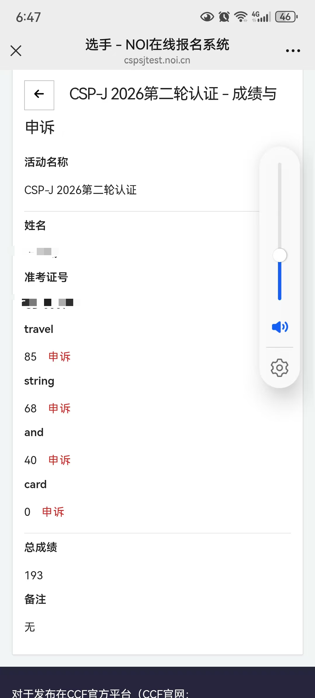

# 前言

啊原来我还没建游记的文档吗 /jk。

这下搞笑了。

虽然还是初中生但已经是四战 CSP 的期颐耄耋古稀的老东西了。

其实压力没那么大了，反正去年已经有 J 一等 S 二等，应付自家集团还是比较稳的。

目标 NOIP，这次，不为别人，只为了我们自己！！！

~~好燃啊，就是不知道在燃啥。~~

如果各位考得不够美满可以看看我的找找自信。我就不信全谷能找到比我分数低的游记。

# Day $-\infty$

上课，困，睡觉，被牢尸薅起来，~~然后接着睡。~~

重复以上过程 $+\infty$ 天。

# Day 0.9

得知班内有一只据称能稳切 J 组前两题（伏笔）的[高冷橙子](https://www.luogu.com.cn/user/2214922)（以下简称 wzc）同样报名了 J/S 两个组。祝他好运~。

# Day 1 初赛

还是 HL 中学 SX 初中部，还是 J 免考。

没车来接送自己挤地铁差大评，周围半天也没个商场吃饭 233。

本来说与 wzc 会师但是他考完 J ~~被吓哭了~~ S 弃考了 QwQ。看了下 J 组题目，中规中矩吧，没有 2024 场那么离谱，但也不算难（闲话：个人感觉 CSP-J 比 CSP-S 要规范很多，因为它有难度上限不能到青、到 S，而 S 组难度上限可就几乎能到 $+\infty$ 了）。

不过为什么监考老师说听过我这个名字啊，走之前还问我我们学校信息老师是谁，~~搁这儿刺探敌情呢还是想拉我过去啊~~。他为啥会认识我啊啊啊啊啊 /jk……

题还是那样，考的一坨，不过好歹过了。考试途中越算越懵不断怀疑自己会不会今年会挂初赛，好在活下来了。

额，好吧，这 TM 啥啊啊啊……我不会！我不会！我不会！（突然发癫）。

# Day 1.2 出分

中间等待过程没啥事儿，该上学上学，该咋地咋地。

$58$ 分，说高不高说低不低，反正能过就行。~~我的初赛就是靠第六感与运气。~~

问了几个 AI 和老师，发现在除了洛谷的地方都认为差不多能过。不过 AI 认为我的分数比较“踩线”。

# Day 1.3 出线

今年 GD 的 S 分数线进一步下跌到 $47$ 分离大谱（是的我们学校真有四十多分过了的），感谢 SZTU 的贡献。另外今年似乎不少省份是卡全国线 $37$ 分来的。

不过再一次证明了你谷估分有多不靠谱。在你谷上完全就是不可过的水平（吐槽：没人发现关掉灌水区后学术版就顺带变成了灌水区吗……把蒟蒻禁言后留一堆 zak 在洛谷上人均 NOIP 一等第一轮 90+ 的，吓哭了）。

不过第二轮报名费好贵啊，扶贫办怎么把我忘了啊啊啊 /kel。

# Day 1.4 出奖项线

最后拿到我个人参与 CSP 获得的合计第 $7$ 个、CSP-S 第一轮第 $4$ 个二等奖。我宣布我是二等奖的神。

# Day 1.5 中间

训练练，摆烂烂（bushi）。

zuo 死在初三停课集训。文化课是啥？体育是神马？

~~不是老师怎么还催我交听说作业呢。~~ 这边直接已读不回。

希望能给我打一回 NOIP 吧。

不过心态放开了：打得好如何，打飞了又如何？我不还是我，该接受还得接受，能把我咋地啊。

~~其实真实心态：CNM，不说 S 一等，再不给我一个 NOIP 体验卡就过分了吧。不是，不给一等也很过分！！！~~

# Day 1.8 参与活动与博客翻新

受邀参与了一个活动，获得奖学金 ￥$1000$，并制作了专属海报。~~额，好像报销完 CSP 报名费就剩 30 了~~。

不过为了赶着活动全面翻新了一下（框架都换了）[个人博客网站](https://www.leo2011.eu.org/)，欢迎大家点进来看看。~~怎么还植入广告捏。~~

~~然后你就会发现杂鱼积木鱼又双叒叕把自己的用户名打错了。~~ 

~~接下来 Block_Fish 将被迫无奈的看着 Blcok_Fish 大战 Block_Fush。~~

话说我打字错别字好像很多啊，但是拼音输入法只能酱紫了 awa。

# Day 1.9 复赛前一天

信心（~~归零~~赛）。

```cpp
unsigned long long rp = ULLONG_MAX;
++rp;  // 教练的比赛
```

集训完去总部拿自己的海报，发现不让领取，最后废了 $3$ 小时收获照片 $5$ 张。

K*C 草莓生椰好喝捏，但是不幸不是疯狂星期四捏。

# Day 2

感觉好像今年记得东西不多啊，可能是太过重复了吧。怎么才 800 多个字符就写到复赛了（好吧加到 $1000$ 出头了）。

## 上午 CSP-J

我又来啦！今年冲个 $350$？

~~你再不 AK 就过分了吧。~~

~~没办法不会做绿。~~

密码 `Trick||Treat?`。万圣节笑话，但是使用 C++ 语言表述。

好吧今年唐飞了（不过已经有 J 一等了无所谓）。T1 秒切，T2 简单思考，不过似乎都没去年快，两道 water 加一块快 1h 了。

T3 依旧被二进制创飞。去年**异或**今年**与**，明年是不是要**或**、后年**非**了？~~往 OI 放这么多数学内容我干嘛不直接去打 MO 啊……~~

好吧是我太菜了不会，我认了。

另外强烈谴责 €€£ 水沝淼㵘数据，把 $n$ 个数从大到小排个序然后 $6$ 个大样例过 $5$ 个；再用 $\operatorname{popcount}(x) = 1$ 判掉 $x = 2 ^ k, k \in \mathbb{N_*}$ 就全过了……不过似乎这个做法随机数据下好像还挺正确的？不过为了保险老老实实打了 $55$ 分部分分。以及考点把 Win 键禁用了，根本看不出来我 i5-12400 CPU 的实力啊（。

T4 看了一眼题面表示谁把语文试卷放上来了（bushi。最后费劲看了半天之后很快想到了贡献法，最后用贡献 + 二分 + 差分乱搞一通，~~大概~~切了，可惜赛前没调出来。

这样子的话我很危险啊，一个题不正确，一个题极有可能爆炸（是的我最后一次修改 T4 的时候时间已经不允许我测样例了。）

~~不会去年 J 300 今年刷分刷成了二等奖吧。~~

## 中午

考点在自家 GM 区。有意思的是只有 GM 和 SM 两个区被分配到了这个考点，然而集团是用 SM 区的名义注册的，因此中午发现考点变成校友会集合点了。

依旧碰上 [Hbh1617](https://www.luogu.com.cn/user/1286360) 等人。

低中部大佬挑战 vp J 组然后被 T4 单杀了。但是 wzc 去哪儿了？我大概也意识到了自己 T4 的问题——大题思路没问题，小细节有点 bug，心里哇凉哇凉的。

为啥 14:30 开考 13:30 就把我们薅过去了……

## 下午 CSP-S

先复习了一下 Linux 指令，上午用 `cp` 测了半天题……（这 TM 是复制！），不过后来发现了神秘指令 `cmp`，可以和 `diff` 作用相近（注：与 `diff` 不同，`cmp` 是按字节比较，不会忽略行末空格和文件末尾换行符之类）。尝试配 Arbiter 测一测，然而不会。

遇到了同级但是没能参与集训的 [zzzMVP](https://www.luogu.com.cn/user/1556954)、靠教练的奖励名额晋级的学妹 [lisaaZPY](https://www.luogu.com.cn/user/1122576)、爆肝 [IDE](https://www.luogu.com.cn/article/fszgaph5) 的 [_Kevin_Huang](https://www.luogu.com.cn/user/1371385) 等人。

::github{repo="KevinHuangIsLearning/shortestpath-ide"}

密码 `Oct31==Dec25?` 也是经典笑话了（$\text{Octal}$ 代表八进制，$\text{Decimal}$ 代表十进制，转换一下可得）。~~去年的“上善若水”还在追我。~~

开题，T1 看上去似乎很简单，但是不对，有问题。前缀和？似乎维护要 $\mathcal{O}(n ^ 2)$ 了；二分答案？似乎没有单调性。（当然，事后发现这两个做法题解区似乎也都有能 AC 的版本。看来大家思考方向相近啊。）

最后写了个 `queue` 维护选了哪些数，涉及到百万次出队入队操作。考虑到 STL 的 `queue` 性能……额，有什么事儿跟 CCF 的 Ultra 9 285K 关闭能效核和 O2 优化说去吧。

差不多 1h 切了，史上最快的一集。好吧还是很慢，但我是 [duel](https://www.luogu.com.cn/problem/P11231) 都能搞 1.5h 的卷心菜。

---

不对，怎么 checker 显示我的题目压缩包有问题？~~给我发成今年 NOIP 的题了？~~

我 chovy 谁么家好人把 checker.exe 也打包进压缩包了！删了之后新的压缩包就正常了。

不过智能化升级版的 checker 可以检测准考证号和姓名是否对应了好评。考场挨个检查 checker 好评。

---

T2 看了半天，结论是和去年 T3 一样，暴力都不可做。跳 T4（教练让我们 T1 打完就倒序开题来着？），似乎比较复杂；只能看 T3 了，这个暴力相对好写，做这个。

T3 的 $40$ 分测完之后其实 NOIP 就稳了，按照往年经验几乎没有超过 $130$ 过。

不过还是写了 T4 的 $12$ 分，虽然样例 $2$ 的第一组输入会神秘输出 $+\infty$，其它倒是很对。调了半天，也不知道为啥。反正差不多得了。

$4$ 道题考 $2$ 道图论 $1$ ~~看着像~~图论差评，~~根本就没有这样的比赛！~~

另外去年 T2 考最小生成树、今年 T2 最短路，明年是不是该轮到我 Tarjan 连通性了？

## 回家

和 wzc 沟通题目难度。伏笔揭露了，他全炸了：

- T1 死于没坐过高铁不知道没有 E 座。
- T2 死于不会双指针
- T3、T4 本来就不会

最后 $80 + 68 + 35 + 0 = 183$ 遗憾离场，预估二等奖，保底就只能三等奖了。

没看洛谷，搞文化课去了，~~再不搞搞就得去一职了。~~

好吧，其实看了一眼，然后发现谷民大众分 $100 + 100 + 70 + 62 = 332$ 吓哭了赶紧跑路。

# Day 2.1

训练，写了一下和考场代码相似度 $99\%$ 的回忆版 S 组 T1 然后挂到 $55$ 分了。啊，原来样例 $4$ 没过，改对了。注意到我考场代码上也有这个神秘的 `abs` 函数而且 $4$ 个大样例都过了，这 $100$ 分保底是有了。T3 的 $40$ 分同理。

按照经验，比较随机的大样例能过一般问题不大。好像赢了（？。提前开[香槟](https://illinois.edu/)吧！

~~不过因为写挂恐吓教练导致被压力，赶去复习双指针了。~~

另外 CCF [原题机](https://codeforces.com/problemset/problem/231/C)差评。~~原来不让上网不是为了防 AI 而是为了防原题机吗。~~

~~水游记。~~ 订 T2。话说这题不比什么[超速检测](https://www.luogu.com.cn/problem/P11232)简单多了。翻了翻别人家的游记，啊原来全世界除了我都会写 S 组 T2 吗。

啊，今天有体测吗？~~体测是什么？不知道，不清楚，不了解，不理会。~~

# Day 2.5 出分

等了半天，终于看到了。强烈谴责 CCF 不发通知。

J 组 $100 + 100 + 90 + 48 = 338$，赢麻了。刷分成功！那么假的做法能 $90$ 分，强烈谴责水沝淼淼数据。T4 样例没测甚至编译都没编译能 $48$，你木鱼叔叔有点东西。

S 组 $100 + 0 + 24 + 0 = 124$，中规中矩吧，我感觉 NOIP 有点那啥了。

哎，爱咋地咋地吧。除了 T4 挂了点儿之外其它都算符合预期了。T3 那么暴力 $24$ 也算合理分数，复杂度假了。

最终努力 $2$ 年，比自己初一高 $4$ 分，我服了。（笑点解析：我初一那场 CSP-S 2024 同样也是 T1 过，T3 暴力，T2、T4 挂蛋）。

不过今年 T1 比决斗难，后面也比较创，应该 NOIP 有戏吧（反正教练说肯定没问题）。

盒：[Chenhaorui88](https://www.luogu.com.cn/user/1432359) 同学获得 $0 + 44 + 24 + 0 = 68$，和我一样将 $101\%$ 的运气用到了 J 组（J 组 $310+$，S 组死于看错题意没能场切 T1 而且写的暴力因为没定义 `ans` 导致整个 CE 了）。[djydjy123](https://www.luogu.com.cn/user/1569609) 大佬因场切 T2 喜获 $100 + 100 + 40 + 15 = 255$。wzc 同学则在 J 组以 $85 + 68 + 40 + 0 = 193$ 的成绩，预估压线二等奖。



考虑到 wzc 同学刚学几个月，算是相当不错的成绩了——虽然 T3 得了 $-7$ 分（bushi。T1 不知道高铁没有 E 座，挂 $15$；T2 不会双指针，挂；T3 $n - 1$ 写成 $m - 1$，挂 $5$ 分；T4 没写。我帮他改完后就 $200+$ 了呢（

~~空悲切。~~

另外禁止写暴戾语言，有人称因为搞这玩意儿收到了 $4$ 个 $-1$。今年 GD 的文件把迷惑行为禁了。


